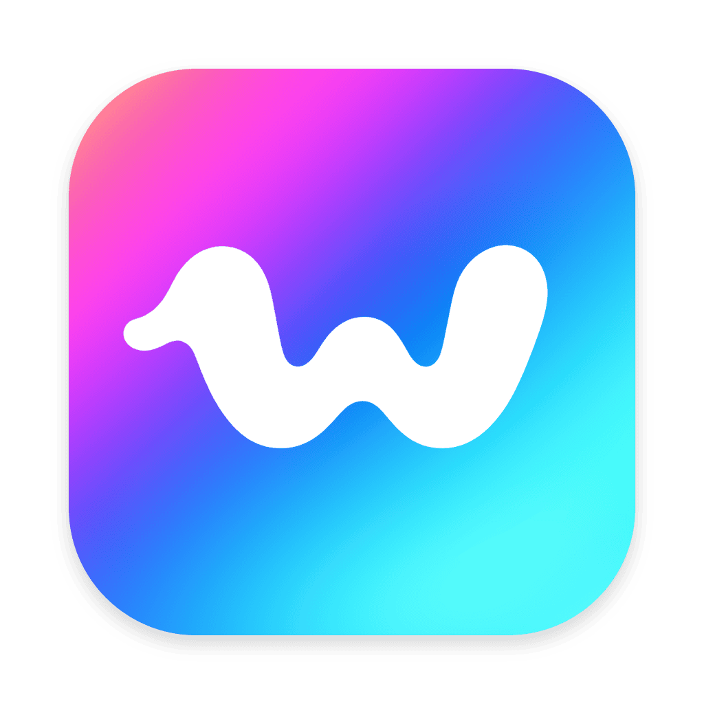

<div align="center">



# Wavo

**Local dictation for macOS, Windows and Linux**

[](#-usage)
[](#-usage)
[](#-usage)
[](https://github.com/vladkens/wavo-app/blob/main/LICENSE)
[](https://x.com/uid127)
[](https://buymeacoffee.com/vladkens)

</div>

**Hold a hotkey, speak, release**, and the text lands where you were typing: a chat, an editor, a terminal, any app. Speech is recognized **on your computer**, on the GPU or a Mac's Neural Engine: no account, no subscription, and your voice never leaves the machine. Wavo lives in the menu bar or the tray.

<p align="center">
  <a href="https://github.com/user-attachments/assets/1826b949-3c28-47e8-a6f4-9affad10cc09"></a>
</p>

## 💡 Why

Wavo is inspired by [Handy](https://github.com/cjpais/Handy) and runs the same GGUF models, the ones [handy-computer](https://huggingface.co/handy-computer) publishes. I built it for the technology: with agents around, there's no reason to put up with apps that aren't native and waste memory and compute.

- Handy is a webview app (Tauri) on its own engine, transcribe.cpp. Wavo draws a native UI on each OS with [nimbo](https://github.com/vladkens/nimbo), light on memory, and runs its own engine, [`wavo-cli`](https://github.com/vladkens/wavo), in pure Rust on the GPU.
- On a Mac with macOS 15 or later, Wavo runs on the Neural Engine: 11 s of speech becomes text in 61 ms on an M2, 2.5× faster than on the GPU and 4.4× faster than transcribe.cpp, for about 6× less energy than the GPU ([measured](https://github.com/vladkens/wavo#-speed)).
- It adds what I missed in Handy: an automatic microphone choice, and a history that can be exported with its recordings.
- Most alternatives are paid at the time of writing, and many are built on Whisper, whose last model came out in 2024. Wavo is free, works offline on macOS, Windows and Linux, and uses newer models, such as Parakeet Ultra.

## 🌟 Features

- 🎙️ **Hold to talk**: hold the hotkey and speak, or tap it to start and stop; Esc cancels
- ⌨️ **Pastes where you type**: into any app, and the clipboard keeps what it held
- 🔒 **Fully local**: no account, no cloud; only the model is downloaded, once
- ⚡ **Fast**: 11 s of speech becomes text in 61 ms on an M2's Neural Engine (macOS 15 or later)
- 🌍 **100 languages**: Parakeet Ultra for 25 European ones, Whisper for the rest
- 💊 **A quiet indicator**: a small pill shows the level while you speak and never takes the focus
- 🎧 **Picks the microphone**: a USB one first, then the built-in one, a Bluetooth headset only when there is nothing else
- 📜 **History**: every dictation with its recording, searchable; play it back, transcribe it again, export it
- 📦 **Shared models**: kept in the standard Hugging Face cache, so other tools that use the same models share them
- 🖥️ **Every desktop**: macOS, Windows and Linux on X11 and Wayland, in about 10 MB

## 🚀 Usage

**Download** the file for your system from the [latest release](https://github.com/vladkens/wavo-app/releases/latest) and run it. Then pick a model in Settings › Models: **Parakeet Ultra** is the recommended one, about 0.7 GB, downloaded once.

<details>
<summary>Which file, and the first launch</summary>

ARM64 is Apple Silicon and other ARM chips; AMD64 is a usual Intel or AMD PC. `<version>` is the release's, such as `v0.1.0`.

- **macOS** 14.2 or later, ARM64: `Wavo-<version>-macos-aarch64.dmg`; open it and drag Wavo into Applications. It is signed and notarized by Apple, so it opens like any other app.
- **Windows** 10 or 11, AMD64: `Wavo-<version>-windows-x64-setup.exe`; ARM64: `Wavo-<version>-windows-arm64-setup.exe`. It installs Wavo for you alone, no administrator needed, with a Start menu entry. It is not signed yet: SmartScreen says "Windows protected your PC", More info → Run anyway. Its icon is in the notification area, perhaps under the ^ arrow.
- **Linux** AMD64: `Wavo-<version>-linux-x86_64.AppImage`; ARM64: `Wavo-<version>-linux-aarch64.AppImage`. Make it executable (`chmod +x`) and run it. On Debian and Ubuntu the `.deb` of the same name installs it instead: `sudo apt install ./Wavo-<version>-linux-x86_64.deb`.

The [dev pre-release](https://github.com/vladkens/wavo-app/releases/tag/dev) has the newest build of `main`, its files named `Wavo-dev-…`.

</details>

<details>
<summary>Linux: Wayland, GNOME and the tray</summary>

On Wayland the desktop asks once to let Wavo paste (at the first paste, or earlier from the menu's "Allow Paste…") and once for the hotkey (from the menu's "Allow the Hotkey…"). The hotkey needs a desktop that offers global shortcuts: KDE Plasma 6, GNOME 48 and later, Hyprland. Elsewhere, as on GNOME before 48 (Ubuntu 24.04) or Sway, add a shortcut in the desktop's keyboard settings that runs `/path/to/Wavo-<version>-linux-<arch>.AppImage toggle` (with the .deb, `wavo-app toggle`): one press starts a dictation, the next stops it.

Wavo's icon goes in the tray, which GNOME needs the AppIndicator extension for (Ubuntu ships it); KDE, Xfce, Cinnamon and MATE have a tray of their own.

The GPU needs a Vulkan driver (`mesa-vulkan-drivers` on Debian and Ubuntu); without one Wavo runs on the CPU, much slower.

</details>

**Hold the hotkey** (Option-Space on macOS, Ctrl+Alt+Space elsewhere), speak and let go: a small indicator shows the level while you speak, and the text is pasted where the cursor was. **A short tap** starts a dictation that the next press ends, for longer talks; **Esc** cancels.

The menu-bar icon opens the recent dictations, the model and the microphone. **Settings** changes the shortcut, the language and the rest, and keeps the **History**: search it, play a recording back, transcribe it again with another model.

<details>
<summary>Moving to another computer</summary>

Export the history with its recordings on the old computer with Advanced › Data › Export…, and bring it in on the new one with Advanced › Data › Import…: the dictations it does not have yet are added.

</details>

<details>
<summary>Moving from Handy</summary>

Handy's history, with its recordings, comes over through an archive; Handy itself is only read. Quit Handy, then run:

```sh
curl -fsSL https://raw.githubusercontent.com/vladkens/wavo-app/main/scripts/handy.py | python3 -
```

It writes `~/Downloads/handy-export.zip`: bring it in with Advanced › Data › Import…. Dictations Wavo already has are left, so importing twice adds nothing. `HANDY_DIR=<folder>` before `python3` reads Handy's data from another folder.

</details>

## 🤖 How it's made

Wavo is built with AI agents following [agents.md](agents.md): I choose what to build, review the changes and test them on real machines. Before agents, I wrote software by hand for years ([macmon](https://github.com/vladkens/macmon), [twscrape](https://github.com/vladkens/twscrape), [ecloop](https://github.com/vladkens/ecloop)). Releases are rare on purpose: I'd rather test and polish a set of changes than ship each one as it lands, and I try not to break your config or data; when something has to break, [changelog.md](changelog.md) says so.

## 🤝 Contributing

Pull requests are welcome, including ones made with agents: point yours at [agents.md](agents.md).

## 📝 License

Distributed under the [MIT License](LICENSE).
